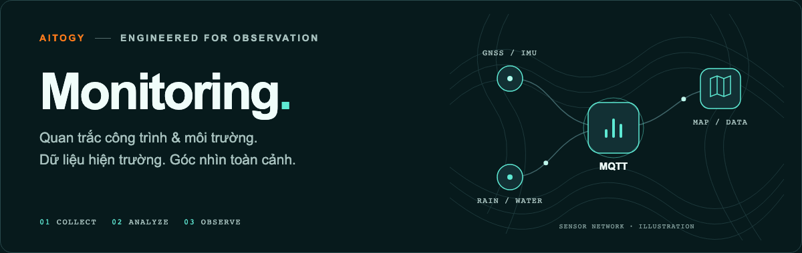
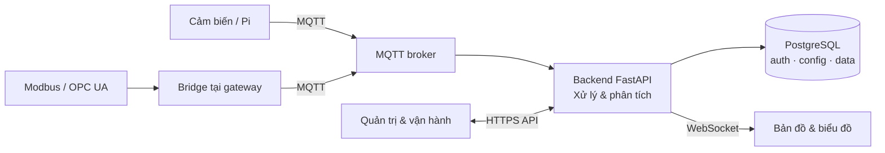

<picture>
  <source media="(prefers-reduced-motion: reduce)" srcset="docs/readme/banner.png">
  
</picture>

<p align="center">
  <a href="https://github.com/tundzai001/land_slide_web/actions/workflows/quality.yml"></a>
  
  
  
  
  
</p>

<p align="center">
  <strong>Từ dữ liệu hiện trường đến quyết định vận hành.</strong><br>
  Nền tảng quan trắc đập, công trình, địa kỹ thuật và môi trường của Aitogy.
</p>

<p align="center">
  <a href="https://monitoring.aitogy.com">Mở hệ thống</a> ·
  <a href="docs/USER_GUIDE.md">Hướng dẫn sử dụng</a> ·
  <a href="docs/OPERATIONS_INTEGRATION.md">Tích hợp thiết bị</a> ·
  <a href="docs/CI_CD.md">CI &amp; phát hành</a> ·
  <a href="SECURITY_READINESS.md">Bảo mật</a>
</p>

---

## Một hệ thống, ba không gian làm việc

| Không gian | Công việc chính |
| :--- | :--- |
| **Cổng truy cập** | Giới thiệu hệ thống, truy cập nhanh bản đồ và quản trị. Đăng nhập trực tiếp mở bản đồ; liên kết tới khu vực được phân quyền giữ đích truy cập. |
| **Bản đồ quan trắc** | Xem dự án, vị trí trạm, trạng thái kết nối và cảnh báo; tra dữ liệu cảm biến, lịch sử và biểu đồ ngay trong không gian bản đồ. |
| **Trung tâm quản trị** | Quản lý người dùng, dự án, trạm, thiết bị Pi, dữ liệu, mô phỏng và công cụ vận hành theo quyền tài khoản. |

## Năng lực chính

| | Có trong dự án |
| :--- | :--- |
| **Quan trắc đa cảm biến** | GNSS, IMU, mưa, mực nước và danh mục cảm biến mở rộng. MQTT thu nhận dữ liệu; WebSocket cập nhật giao diện. |
| **Bản đồ & lớp dữ liệu** | Chuyển nền đường phố, vệ tinh, hybrid và địa hình; giữ vị trí/zoom khi đổi nền. Heatmap thể hiện các điểm cảnh báo và nguy cấp. |
| **Biểu đồ & lịch sử** | Chọn khoảng thời gian, lọc chuỗi đo, xem thống kê, phóng to và làm mới; xuất CSV hoặc ảnh biểu đồ. |
| **GNSS & phân tích** | Xử lý dữ liệu GNSS, cấu hình gốc, chuyển vị, vận tốc, cụm bình sai và báo cáo chuyên ngành. |
| **Mô phỏng 3D** | Không gian mô phỏng, kết quả tính toán và báo cáo theo cấu hình dự án. |
| **Thiết bị hiện trường** | Đăng ký, kích hoạt, cấp license và gán Pi vào trạm; bridge Modbus RTU/TCP hoặc OPC UA sang MQTT là tùy chọn tại gateway. |
| **Vận hành** | Sao lưu PostgreSQL, xác minh archive, phục hồi vào database cô lập, audit log, nhật ký vận hành và đo độ lệch thời gian NTP. |
| **Giao diện thống nhất** | Light/dark, chuyển theme có animation và reduced motion, bố cục desktop/mobile, trạng thái loading, lỗi và thao tác bàn phím. |

Các khả năng phụ thuộc cảm biến, quyền tài khoản và cấu hình triển khai. Banner phía trên là minh họa luồng dữ liệu; badge CI phản ánh trạng thái workflow trên nhánh `main`.

## Dữ liệu đi qua hệ thống thế nào?



Bridge công nghiệp chạy tại hiện trường. Backend dùng chung luồng MQTT để xử lý, lưu và cung cấp dữ liệu. Hệ thống dùng ba database PostgreSQL riêng cho tài khoản, cấu hình và dữ liệu quan trắc.

## Chạy dự án

**Môi trường:** Python 3.11, Node.js 22 và PostgreSQL. Cấu hình MQTT khi cần thu dữ liệu thiết bị. Công cụ backup cần `pg_dump` và `pg_restore` tương thích với phiên bản PostgreSQL của máy chủ.

### 1. Cài đặt và build frontend

```bash
git clone https://github.com/tundzai001/land_slide_web.git
cd land_slide_web
npm ci
npm run build:frontend
```

### 2. Tạo môi trường Python

```bash
python -m venv .venv
```

<details>
<summary>Kích hoạt môi trường theo hệ điều hành</summary>

**Windows PowerShell**

```powershell
.venv\Scripts\Activate.ps1
```

**Windows CMD**

```bat
.venv\Scripts\activate.bat
```

**macOS / Linux**

```bash
source .venv/bin/activate
```

</details>

```bash
python -m pip install -r backend/requirements.txt
```

### 3. Cấu hình riêng cho môi trường triển khai

Tạo `backend/.env` trên máy chạy ứng dụng. File này được Git bỏ qua. Tạo ba database PostgreSQL và điền thông tin kết nối của môi trường đó:

```dotenv
ENVIRONMENT=production
AUTH_DB_URL=postgresql+asyncpg://APP_USER:URL_ENCODED_PASSWORD@DB_HOST:5432/AUTH_DATABASE
CONFIG_DB_URL=postgresql+asyncpg://APP_USER:URL_ENCODED_PASSWORD@DB_HOST:5432/CONFIG_DATABASE
DATA_DB_URL=postgresql+asyncpg://APP_USER:URL_ENCODED_PASSWORD@DB_HOST:5432/DATA_DATABASE

SECRET_KEY=REPLACE_WITH_A_RANDOM_PRIVATE_KEY
BACKUP_SIGNING_KEY=REPLACE_WITH_ANOTHER_RANDOM_PRIVATE_KEY
PUBLIC_SITE_URL=https://YOUR_DOMAIN
CORS_ORIGINS=https://YOUR_DOMAIN
PUBLIC_MONITORING_ENABLED=false
RESCUE_REQUEST_ENABLED=false

MQTT_BROKER=YOUR_BROKER
MQTT_PORT=1883
MQTT_USER=YOUR_MQTT_USER
MQTT_PASSWORD=YOUR_PRIVATE_MQTT_PASSWORD
```

Các giá trị phía trên là placeholder. Sinh **hai khóa riêng biệt**, mỗi lần bằng:

```bash
python -c "import secrets; print(secrets.token_urlsafe(48))"
```

Giữ khóa ổn định giữa các lần khởi động. Đổi `SECRET_KEY` kết thúc các phiên đăng nhập hiện có. Mật khẩu chứa ký tự đặc biệt trong URL database phải được URL-encode.

<details>
<summary>Cài mới: schema và tài khoản quản trị</summary>

Với **database mới, trống**, đặt tạm `RUN_SCHEMA_BOOTSTRAP=true` và `BOOTSTRAP_ADMIN_PASSWORD` là mật khẩu riêng có ít nhất 12 ký tự, tối đa 72 byte UTF-8. Lần khởi động đầu tạo schema và tài khoản `admin` nếu chưa tồn tại. Sau đó tắt `RUN_SCHEMA_BOOTSTRAP` và bỏ `BOOTSTRAP_ADMIN_PASSWORD` khỏi môi trường.

Với hệ thống đang có dữ liệu, sao lưu trước và áp dụng migration theo [hướng dẫn vận hành](docs/OPERATIONS_INTEGRATION.md). Không dùng bootstrap thay cho quy trình migration production.

</details>

### 4. Khởi động

```bash
cd backend
python server.py
```

Ứng dụng lắng nghe cổng `8001`. Production cần HTTPS ở reverse proxy và domain khớp `PUBLIC_SITE_URL` / `CORS_ORIGINS`. Cookie production dùng thuộc tính Secure; đăng nhập cần truy cập qua HTTPS.

| Kiểm tra | Endpoint |
| :--- | :--- |
| Process đang hoạt động | `/api/health/live` |
| Mức sẵn sàng của dịch vụ | `/api/health/ready` |

## Chất lượng & phát hành

[](https://github.com/tundzai001/land_slide_web/actions/workflows/quality.yml)

Workflow chạy trên pull request và mỗi lần push `main`:

1. Cài phụ thuộc và chạy toàn bộ backend test trên Python 3.11, với cấu hình test cô lập.
2. Build frontend, đối chiếu tài nguyên đã commit và chạy các bài UI Chromium được chọn.
3. Khi hai bước đạt trên `main`, tạo artifact `monitoring-release-<commit>`, giữ 14 ngày.

Build có thể tái tạo: cùng nguồn và lockfile sinh cùng tài nguyên; file metadata của máy phát triển và thời điểm build không làm đổi kết quả. Artifact chứa mã và tài nguyên đã kiểm tra; [quy trình CI hiện tại](docs/CI_CD.md) chưa tự triển khai lên máy chủ production.

## Bảo mật theo từng lớp

- **Phiên đăng nhập:** cookie HttpOnly/Secure, CSRF cho request thay đổi dùng cookie, thời hạn phiên và thu hồi phiên.
- **Phân quyền:** kiểm tra vai trò/quyền và dự án được gán tại backend; giới hạn luồng WebSocket theo phạm vi tài khoản.
- **Đầu vào & dữ liệu:** validation, che thông tin nhạy cảm trong lỗi/audit, lọc trường API công khai và xử lý an toàn metadata thiết bị trên UI.
- **Vận hành:** khóa ký backup, checksum, log và cơ chế phục hồi vào database cô lập.

Phạm vi kiểm chứng và các phần còn thiếu được ghi trong [Security readiness](SECURITY_READINESS.md). Tài liệu này là bằng chứng kỹ thuật; dự án chưa công bố chứng nhận ISO 27001 hoặc ISO 9001.

## Bản đồ mã nguồn

```text
land_slide_web/
├── backend/
│   ├── app/                 # API, phân quyền, MQTT, persistence và feature domains
│   ├── processors/          # Xử lý GNSS, cảm biến và phân tích
│   ├── alembic/             # Migration
│   └── tests/               # Backend và hợp đồng hệ thống
├── frontend/
│   ├── js/                  # Modules, templates và runtime
│   ├── css/                 # Theme và giao diện
│   └── dist/                # Tài nguyên production đã build
├── field_unit/              # Pi và bridge công nghiệp
├── tests/ui/                # Playwright
├── scripts/                 # Công cụ build
└── docs/                    # Sử dụng, tích hợp và vận hành
```

## Tài liệu dành cho từng công việc

| Công việc | Tài liệu |
| :--- | :--- |
| Sử dụng giao diện | [Cẩm nang](docs/USER_GUIDE.md) · [PDF](docs/USER_GUIDE.pdf) |
| Tích hợp & vận hành | [Hướng dẫn](docs/OPERATIONS_INTEGRATION.md) · [PDF](docs/OPERATIONS_INTEGRATION.pdf) |
| Phát hành | [CI/CD](docs/CI_CD.md) |
| Hiểu backend | [Kiến trúc](backend/app/ARCHITECTURE.md) |
| Phát triển frontend | [Module map](frontend/MODULES.md) · [Design system](design-system/aitogy-landslide-monitor/MASTER.md) |
| Cấu hình cảm biến | [Monitoring sensors](docs/monitoring-sensors.md) |
| Khôi phục GNSS | [Monitoring recovery](docs/GNSS_MONITORING_RECOVERY.md) |
| Kiểm soát an toàn thông tin | [Security readiness](SECURITY_READINESS.md) |

---

<p align="center"><strong>AITOGY · Monitoring</strong><br>Quan sát có hệ thống. Vận hành có dữ liệu.</p>
