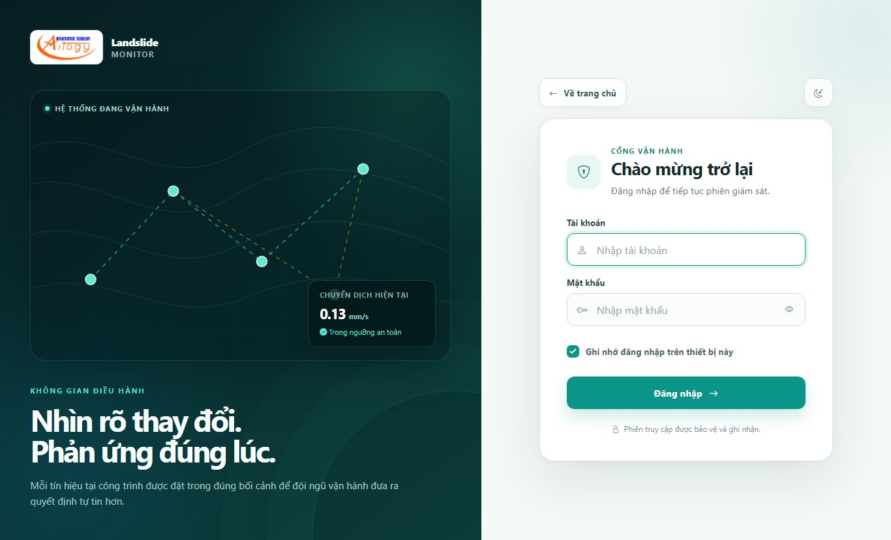
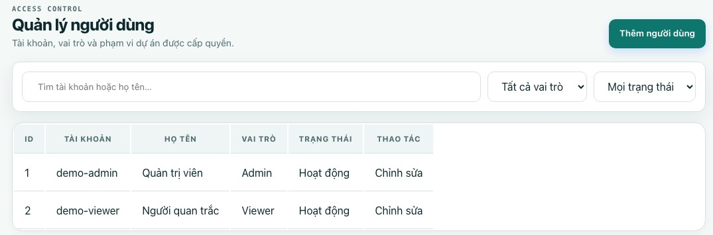
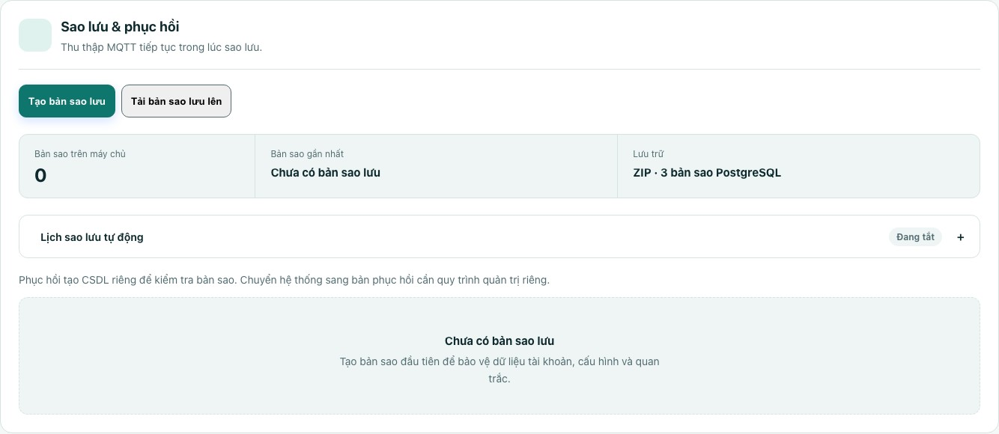
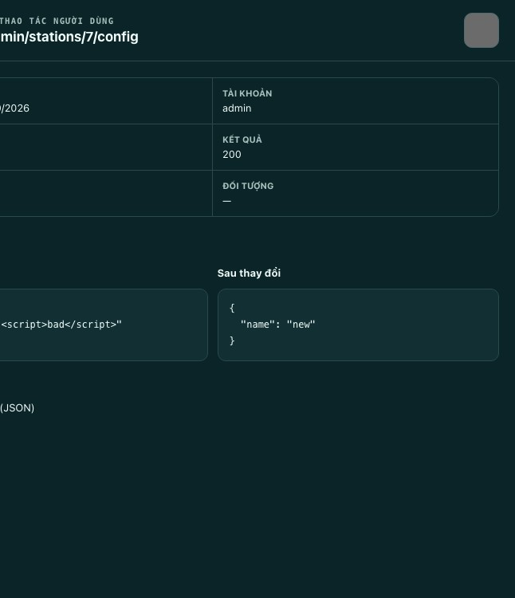
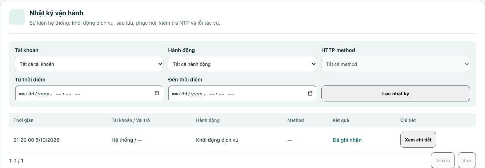
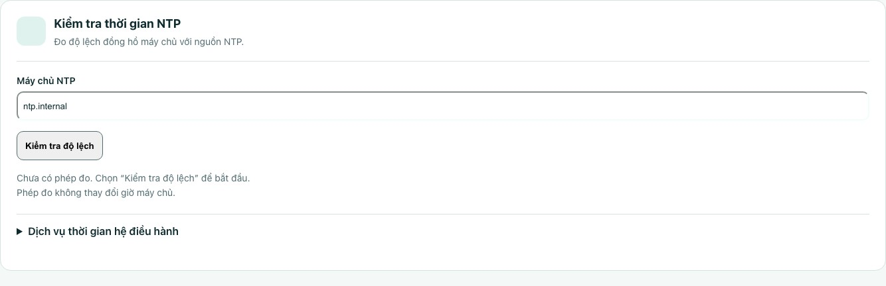

# Hướng dẫn sử dụng web

LANDSLIDE MONITOR · AITOGY

**Quan trắc công trình. Theo dõi dữ liệu. Kiểm soát vận hành.**

Cẩm nang thao tác dành cho người quan trắc và quản trị viên.

Phiên bản tháng 10/2026. Ảnh minh họa dùng dữ liệu mẫu; quyền truy cập và dữ liệu hiển thị phụ thuộc tài khoản được cấp.

---

## Mục lục & tra cứu nhanh

**01 · Bắt đầu & tài khoản** ................................ Trang 3

Đăng nhập, tìm người dùng, kiểm tra vai trò và phạm vi được cấp.

**02 · Tìm đúng khu vực làm việc** ....................... Trang 4

Bản đồ, dự án, trạm quan trắc và các khu vực quản trị.

**03 · Tra cứu & xuất dữ liệu** ............................ Trang 5

Chọn dữ liệu, lọc theo trạm và thời gian, mở chi tiết, tải CSV/Excel.

**04 · Sao lưu & phục hồi** ................................ Trang 6

Tạo bản sao, tải về, cấu hình lịch và kiểm tra phục hồi.

**05 · Audit log** .............................................. Trang 7

Ai thao tác, hành động nào, kết quả và dữ liệu trước/sau.

**06 · Nhật ký vận hành** ................................... Trang 8

Theo dõi sự kiện dịch vụ, sao lưu và các tác vụ hệ thống.

**07 · Thời gian hệ thống & hỗ trợ** ...................... Trang 9

Kiểm tra NTP, đọc kết quả và tải tài liệu khi cần.

### Quy trình mỗi ca trực

1. Kiểm tra trạm đang nhận dữ liệu và thời điểm bản ghi gần nhất.

2. Tra cứu cảnh báo, đối chiếu lịch sử và ghi nhận sự cố theo quy trình đơn vị.

3. Kiểm tra nhật ký tác vụ và tình trạng sao lưu trước khi bàn giao.

---

## 01 · Bắt đầu & tài khoản

**Mục tiêu:** vào đúng hệ thống và làm việc trong phạm vi được cấp.

1. Mở địa chỉ web do đơn vị vận hành cung cấp. Nhập tài khoản và mật khẩu rồi đăng nhập.

2. Tại Trung tâm quản trị, chọn **Người dùng**. Tìm theo tài khoản hoặc họ tên; lọc theo vai trò và trạng thái.

3. Quản trị viên có thể thêm hoặc chỉnh sửa người dùng. Kiểm tra quyền chức năng và dự án được giao trước khi lưu.

### Hiểu vai trò

**Admin:** quản trị tài khoản, cấu hình và các chức năng được cấp.

**Operator:** vận hành theo quyền chức năng và dự án được giao.

**Viewer:** xem dữ liệu trong phạm vi được cấp. Không mặc định có quyền thay đổi cấu hình.

**Khi không thấy chức năng:** kiểm tra quyền với quản trị viên. Vai trò, quyền chi tiết và dự án cùng quyết định phạm vi truy cập.

Kết thúc phiên làm việc bằng **Đăng xuất** ở cột trái, đặc biệt trên máy dùng chung.

---

## 02 · Tìm đúng khu vực làm việc

**Từ Trung tâm quản trị:** bấm logo Landslide ở đầu cột trái để về **Bản đồ**. Chọn dự án hoặc trạm cần theo dõi và mở màn hình quan trắc tương ứng.

### Bản đồ & quan trắc

Kiểm tra vị trí trạm, trạng thái và thời điểm dữ liệu gần nhất. Mở trạm để xem số liệu và biểu đồ; chọn khoảng thời gian phù hợp trước khi so sánh.

### Dự án

Chọn **Dự án**, mở dự án rồi đi tiếp tới cụm/trạm. Dùng breadcrumb hoặc **Quay lại** để trở về cấp trước. Kiểm tra đúng trạm trước khi sửa cấu hình thiết bị.

### Catalog chức năng

**Người dùng** · Tài khoản, vai trò, trạng thái và phạm vi dự án.

**Database** · Bảng dữ liệu, bộ lọc, chi tiết bản ghi và xuất dữ liệu.

**Mô phỏng** · Các kịch bản và chức năng mô phỏng được cấp quyền.

**Pi Devices** · Quản lý thiết bị Pi hiện trường và cấu hình liên quan.

**Cứu hộ** · Tra cứu và xử lý thông tin phục vụ ứng phó sự cố theo quyền.

**Vận hành** · Sao lưu, Audit log, nhật ký vận hành và kiểm tra thời gian.

### Nhớ kiểm tra thời điểm

Trạm có số liệu không có nghĩa số liệu đang mới. Đối chiếu thời gian bản ghi gần nhất với thời gian hiện tại và chu kỳ thu thập của trạm.

Nếu thiếu dữ liệu, kiểm tra trạm/thiết bị, bộ lọc thời gian và tình trạng kết nối trước khi thay đổi cấu hình.

---

## 03 · Tra cứu & xuất dữ liệu

**Mục tiêu:** lấy đúng tập dữ liệu cần phân tích hoặc bàn giao.

1. Chọn **Database** ở cột trái. Chọn dataset cần xem: trạm, thiết bị, dữ liệu cảm biến hoặc cảnh báo.

2. Chọn dự án, trạm, loại cảm biến và khoảng thời gian nếu bộ lọc của dataset hỗ trợ. Làm mới để cập nhật kết quả.

3. Chọn một bản ghi để xem thông tin trong bảng chi tiết bên phải. Đối chiếu thời gian, loại cảm biến và trạm trước khi dùng số liệu.

4. Bấm **Xuất dữ liệu**, chọn dataset và bộ lọc. Chọn **CSV** hoặc **CSV + Excel** rồi bắt đầu tác vụ.

5. Chờ tác vụ hoàn tất và tải gói kết quả. Giải nén để đọc các tệp dữ liệu/báo cáo được chọn.

### Chọn định dạng

**CSV:** phù hợp dữ liệu lớn và nhập vào phần mềm phân tích.

**CSV + Excel:** thuận tiện đọc bảng và tổng hợp trong Excel. Gói kết quả có thể chứa nhiều tệp theo dataset.

Báo cáo chuyên ngành có thể có PDF/Excel tùy loại dữ liệu và tác vụ được chọn.

### Trước khi gửi báo cáo

Kiểm tra đúng dự án, trạm, khoảng thời gian, đơn vị đo và số lượng bản ghi. Bộ lọc quá rộng khiến tác vụ lâu hơn và tệp lớn hơn.

Không dùng nút **Xóa dữ liệu** để làm mới danh sách. Đây là thao tác quản trị thay đổi dữ liệu.

---

## 04 · Sao lưu & phục hồi

**Sao lưu dữ liệu hệ thống:** tài khoản, phân quyền, cấu hình, dữ liệu quan trắc và nhật ký. Bản sao được đóng gói thành **ZIP**, lưu trên máy chủ.

1. Chọn **Vận hành > Sao lưu & phục hồi**. Bấm **Tạo bản sao lưu** và chờ tác vụ hoàn tất.

2. Bản sao xuất hiện trong danh sách. Bấm **Tải về** ở bản sao cần giữ để lưu thêm một bản trên máy đang sử dụng.

3. Mở **Lịch sao lưu tự động**, chọn tần suất, thời điểm bắt đầu và số bản tự động cần giữ. Bấm **Lưu lịch**.

4. Khi cần kiểm tra bản sao ngoài hệ thống, dùng **Tải bản sao lưu lên**. Sau khi xác minh, chọn phục hồi kiểm tra theo chức năng được cấp.

**Phục hồi kiểm tra tạo CSDL riêng.** Nó không tự thay thế dữ liệu đang chạy. Chuyển hệ thống sang dữ liệu phục hồi cần quản trị viên thực hiện quy trình riêng.

Bản sao dữ liệu không gồm mã nguồn, tệp tải lên và cấu hình triển khai. Cần giữ riêng các thành phần này trong kế hoạch khôi phục toàn hệ thống.

---

## 05 · Audit log: ai đã làm gì?

**Audit log** ghi vết thao tác người dùng: tài khoản, vai trò, hành động, đối tượng, kết quả và thay đổi dữ liệu khi có.

1. Chọn **Vận hành > Audit log**.

2. Chọn tài khoản trong danh sách. Lọc theo hành động, HTTP method, thời gian hoặc từ khóa phù hợp. Bấm **Lọc nhật ký**.

3. Bấm **Xem chi tiết** để mở bảng bên phải. Đối chiếu thông tin yêu cầu và dữ liệu trước/sau thay đổi. Bấm nút đóng hoặc **Esc** để quay lại danh sách.

### Đọc HTTP method

**GET:** đọc dữ liệu, mở danh sách hoặc tải tệp.

**POST:** gửi yêu cầu tạo mới hoặc khởi chạy tác vụ.

**PUT/PATCH:** cập nhật dữ liệu. **DELETE:** yêu cầu xóa.

Tên hành động và kết quả mới xác định yêu cầu thực hiện gì và có thành công không. Một yêu cầu bị từ chối vẫn có thể xuất hiện trong Audit log.

---

## 06 · Nhật ký vận hành: hệ thống đã làm gì?

**Nhật ký vận hành** ghi sự kiện dịch vụ và tác vụ: khởi động, sao lưu, phục hồi, kiểm tra NTP hoặc lỗi xử lý.

1. Chọn **Vận hành > Nhật ký vận hành**.

2. Lọc theo sự kiện và thời gian. Dùng từ khóa để tìm tác vụ cần kiểm tra.

3. Mở **Xem chi tiết** và đọc thông tin kết quả/lỗi. Đối chiếu thời gian với tác vụ người dùng vừa khởi chạy.

### Phân biệt hai loại nhật ký

**Audit log:** người dùng nào gửi yêu cầu gì, tới đối tượng nào, kết quả ra sao.

**Nhật ký vận hành:** dịch vụ hoặc tác vụ nào chạy, hoàn tất hay gặp lỗi.

Một lần tạo sao lưu có thể có cả yêu cầu người dùng trong Audit log và sự kiện tác vụ hoàn tất trong nhật ký vận hành.

Bộ lọc HTTP method không áp dụng cho nhật ký vận hành. Đây là sự kiện hệ thống, không phải danh sách yêu cầu HTTP.

---

## 07 · Thời gian hệ thống & hỗ trợ

Chọn **Vận hành > Thời gian hệ thống** để đo độ lệch đồng hồ máy chủ so với nguồn NTP đã cấu hình.

1. Bấm **Kiểm tra độ lệch** và chờ kết quả.

2. Đọc thời điểm đo, độ lệch tính bằng ms, thời gian khứ hồi và stratum. Đây là phép đo tại thời điểm kiểm tra.

3. Mở mục dịch vụ thời gian hệ điều hành để đọc trạng thái nếu cần. Phép đo trên web không chỉnh đồng hồ máy chủ.

### Nếu kiểm tra thất bại

Ghi lại thời điểm và thông báo lỗi, chuyển cho người quản trị máy chủ kiểm tra nguồn NTP và kết nối mạng. Không dùng lỗi NTP để kết luận rằng dữ liệu cảm biến đã sai.

### Tải tài liệu

Cuối cột trái có **Hướng dẫn sử dụng** và **Hướng dẫn tích hợp**. Bấm một lần để tải PDF. Trình duyệt có thể hỏi nơi lưu theo cài đặt tải xuống của máy.

Hướng dẫn sử dụng dành cho thao tác web. Hướng dẫn tích hợp dành cho kỹ thuật viên: MQTT/REST, cấu hình máy chủ và quy trình bảo trì.

Khi báo lỗi, gửi tên màn hình, thời gian xảy ra và ảnh thông báo. Không gửi mật khẩu hoặc khóa truy cập.
