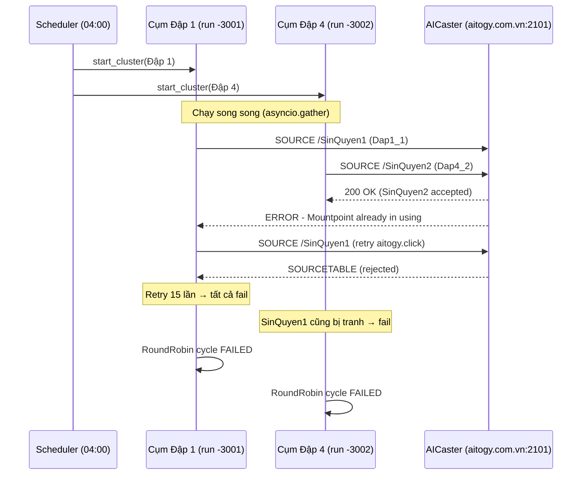

# Điều tra: Tại sao bình sai tự động không ra kết quả

## Tóm tắt

**Scheduler ĐÃ CHẠY đúng lịch** — vấn đề KHÔNG phải scheduler. Bình sai tự động đã được trigger đúng lúc 04:00, 08:00, 12:00 hôm nay (18/08/2026) cho project 3 (Sin_Quyen_2026), cả 2 cụm Đập 1 và Đập 4.

**Nguyên nhân thực sự: NTRIP Caster từ chối mountpoint — tất cả 6 lần chạy đều FAIL.**

---

## Bằng chứng từ Log Production (`C:\Users\len\Desktop\landslide_system.log`)

### Scheduler kích hoạt thành công

| Thời gian | Project | Cụm | Run ID | Kết quả |
|-----------|---------|-----|--------|---------|
| 04:00:00 | 3 (Sin_Quyen_2026) | Đập 1 | -3001 | ❌ FAILED |
| 04:00:00 | 3 (Sin_Quyen_2026) | Đập 4 | -3002 | ❌ FAILED |
| 08:00:00 | 3 (Sin_Quyen_2026) | Đập 1 | -3001 | ❌ FAILED |
| 08:00:00 | 3 (Sin_Quyen_2026) | Đập 4 | -3002 | ❌ FAILED |
| 12:00:00 | 3 (Sin_Quyen_2026) | Đập 1 | -3001 | ❌ FAILED |
| 12:00:00 | 3 (Sin_Quyen_2026) | Đập 4 | -3002 | ❌ FAILED |

### Lỗi giống hệt nhau ở cả 6 lần

```
Caster rejected SOURCE /SinQuyen1: ERROR - Mountpoint already in using
```

```
Caster returned SOURCETABLE instead of accepting SOURCE /SinQuyen2;
verify the configured mountpoint, source password, and upload protocol
```

Hệ thống đã thử cả 2 host: `aitogy.com.vn:2101` và `aitogy.click:2101` — đều thất bại.

### Kết quả cuối cùng (round-robin cycle)

```
RoundRobin cycle failed for project -3001:
  Temporary-BASE coverage is insufficient:
  missing productive base rotation(s) dap1_1, dap1_2, dap1_4;
  cross-baseline graph remains disconnected (components: Dap1_4 | Dap1_2 | Dap1_1)

RoundRobin cycle failed for project -3002:
  Temporary-BASE coverage is insufficient:
  missing productive base rotation(s) dap4_1, dap4_2;
  cross-baseline graph remains disconnected (components: Dap4_2 | Dap4_1)
```

Failure reports đã được ghi tại:
```
C:\inetpub\wwwroot\land_slide_web\backend\static\adjustments\sin-quyen-2026\dap-1\run--3001\
C:\inetpub\wwwroot\land_slide_web\backend\static\adjustments\sin-quyen-2026\dap-4\run--3002\
```

---

## Phân tích nguyên nhân gốc

### Vấn đề: "Mountpoint already in using"

Khi Round-Robin cần chuyển một rover thành temporary BASE, nó phải:
1. Gửi `mode rover survey` → OK ✅
2. Mở NTRIP SOURCE fanout qua caster để push RTCM corrections → **FAIL** ❌

Caster từ chối vì mountpoint (`SinQuyen1`, `SinQuyen2`) **đã có một kết nối SOURCE khác đang chiếm**.

**Nguyên nhân có thể:**
1. **Receiver vật lý vẫn đang đẩy RTCM lên mountpoint** — base station gốc (SinQuyen1/SinQuyen2) vẫn đang hoạt động và chiếm mountpoint khi hệ thống cố mở SOURCE mới
2. **Phiên NTRIP SOURCE cũ chưa được đóng sạch** — phiên trước bị crash/timeout nhưng caster vẫn giữ session
3. **Hai cụm Đập 1 và Đập 4 chạy song song tranh giành mountpoint** — cả hai đều cần SinQuyen1 VÀ SinQuyen2

### Xung đột song song giữa hai cụm

Nhìn kỹ log, cả Đập 1 (Dap1_1) và Đập 4 (Dap4_2) đều cố mở fanout đến **cùng** SinQuyen1 VÀ SinQuyen2 cùng lúc:

```
04:00:33,292 - Dap1_1: priming fanout aitogy.com.vn:2101/SinQuyen1,SinQuyen2
04:00:33,546 - Dap4_2: priming fanout aitogy.com.vn:2101/SinQuyen2,SinQuyen1
```

→ Hai cụm tranh nhau mountpoint → caster reject cả hai.

---

## Sơ đồ luồng lỗi



---

## Đề xuất sửa lỗi

### Phase 1: Khắc phục xung đột mountpoint song song (CRITICAL)

**Vấn đề core**: Hai cụm Đập 1 và Đập 4 dùng chung cùng NTRIP caster và mountpoints (SinQuyen1, SinQuyen2). Khi chạy song song bằng `asyncio.gather`, chúng tranh giành SOURCE connection.

**Giải pháp**: Tuần tự hóa (serialize) các cluster runs khi chúng chia sẻ mountpoint/caster resources, HOẶC đảm bảo mỗi cụm chỉ fanout đến mountpoint của riêng nó.

**File cần sửa**: [`scheduler.py:289`](file:///C:/Users/len/Desktop/tun/land_slide_web/backend/app/infrastructure/scheduler.py#L286-L292)

```diff
-            # Independent project clusters own independent manager sessions.
-            await asyncio.gather(*(start_cluster(item) for item in cluster_runs))
+            # Serialize cluster runs to prevent NTRIP mountpoint contention.
+            # Clusters sharing the same caster/mountpoint will deadlock if
+            # their fanout attempts overlap.
+            for item in cluster_runs:
+                await start_cluster(item)
```

### Phase 2: Xử lý "Mountpoint already in using" trên caster

Trước khi mở SOURCE mới, hệ thống cần đảm bảo mountpoint cũ đã được release:
- Kiểm tra xem receiver gốc (base station) đã ngắt RTCM SOURCE chưa
- Thêm logic chờ mountpoint free (với timeout) trước khi retry

### Phase 3: Thêm diagnostic logging

Thêm log chi tiết hơn khi phát hiện xung đột mountpoint giữa các cụm.

### Phase 4: Context cleanup khi fail (đề phòng)

Cleanup `adjustment_run_contexts` khi exception xảy ra sau khi đã ghi STARTING status, tránh việc schedule tiếp theo bị skip do context cũ stuck.

**File cần sửa**: [`scheduler.py:294-301`](file:///C:/Users/len/Desktop/tun/land_slide_web/backend/app/infrastructure/scheduler.py#L294-L301)

---

## Kế hoạch xác minh

### Automated Tests
```bash
cd backend
python -m pytest tests/test_auto_adjustment_scheduler.py -v
python -m pytest tests/test_ntrip_round_robin_transport.py -v
```

### Manual Verification
1. Sau khi sửa, set `scheduled_hours` thành thời gian 5 phút sau
2. Quan sát log xem:
   - Các cụm có chạy tuần tự không
   - SOURCE fanout có thành công không
   - Round-Robin cycle có hoàn thành không
3. Kiểm tra kết quả bình sai trên UI

---

## Open Questions

> **1. Hai cụm Đập 1 và Đập 4 có PHẢI dùng chung mountpoint SinQuyen1/SinQuyen2 không?**
> Nếu mỗi cụm có thể dùng mountpoint riêng → cấu hình lại cluster config trong DB. Nếu bắt buộc chia sẻ → phải serialize.

> **2. Base station vật lý (SinQuyen1/SinQuyen2) có cần được tắt SOURCE trước khi adjustment không?**
> Log cho thấy "Mountpoint already in using" → có thể receiver gốc vẫn đang push RTCM lên caster.

> **3. Caster `aitogy.click:2101` có được cấu hình đúng chưa?**
> Tất cả request đến `aitogy.click` đều nhận `SOURCETABLE` thay vì accept → có thể mountpoint chưa được đăng ký trên caster backup này.
